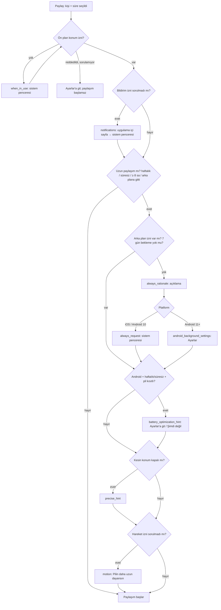
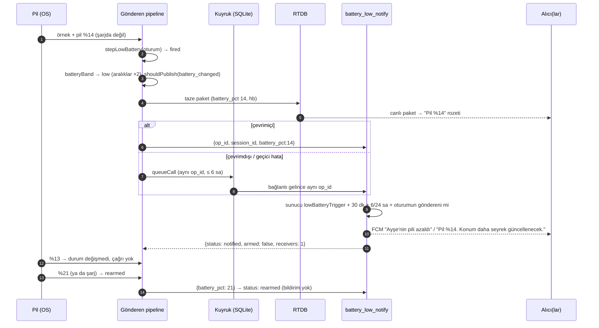

# Faz 3: Arka Plan Takibi, Pil Optimizasyonu ve Çevrimdışı Dayanıklılık

Faz 3, Faz 1 ve Faz 2 sözleşmelerini **genişletir**: pakete yalnızca isteğe bağlı alanlar eklendi (`hb`, `q`,
`recorded_at`), mevcut alanların anlamı değişmedi (`timestamp` hâlâ sunucu saatine göre ölçüm anıdır). Çelişki olursa
`packages/core` geçerlidir. Bu belgede **[Varsayım]** ile işaretlenen her şey gerçek cihazda ölçülerek doğrulanmalıdır.

**Durum:** Kod hazır. Birim, kural, emülatör ve uçtan uca testler geçiyor (§4.1). Gerçek cihazda denenmedi.
`modules/konum-activity` içindeki Swift ve Kotlin kodu bu ortamda **derlenmedi** (Xcode ve Android SDK yok). Modül
yoksa JS sarmalayıcısı güvenli varsayılana düşüyor ve hareket durumu yalnızca hız ve yer değiştirmeden çıkarılıyor.

| Hedef | Nerede |
| --- | --- |
| Hareket durumu makinesi, takip matrisi, kuyruk planı, %15 tetikleyicisi, alıcı durumu, izin planlayıcısı, simülasyon | `packages/core/src/{motion,trackingMatrix,outbox,battery,receiverStatus,permissionFlow,simulate}.ts` |
| Uyarlamalı takip (plan → OS isteği, uyku çiti, 60 sn zamanlayıcı) | `apps/mobile/src/services/location/adaptive/` |
| Hareket etkinliği (iOS CMMotionActivityManager, Android Activity Recognition Transition) | `apps/mobile/modules/konum-activity/` |
| Çevrimdışı kuyruk (SQLite, AsyncStorage yedeği) | `apps/mobile/src/services/outbox/` |
| İzin akışı | `apps/mobile/src/features/permissions/{PermissionFlow,BackgroundPermissionHint}.tsx`, `permissionPlanner.ts` |
| Alıcı ekranı (son doğrulanmış konum, iz, pil rozeti) | `apps/mobile/src/features/map/{IncomingStrip,FriendMarker,MapCanvas}.tsx`, `apps/web/src/viewer/model.ts` |
| `live_trail` kuralları, `battery_low_notify`, `share_stall_watchdog` | `backend/database.rules.json`, `backend/functions/src/handlers/{battery,watchdog}.ts` |
| Uçtan uca kabul testi | `apps/web/e2e/faz3/` (`run-faz3.sh`) |

---

## 1. Arka plan servis ve izin mimarisi

### 1.1 Ortak çalışma modeli

```text
Konum örneği (expo-location görevi)  ─┐
OS hareket olayı (konum-activity)    ─┤
Uyku çiti çıkışı (konum-sleep-geofence)┼─► pipeline.handleSamples / handleMotionEvent
60 sn zamanlayıcı (tick)              ─┤        │
FCM resume_tracking (sessiz push)    ─┘        ▼
                                  core motionReducer ─► MotionState (stationary … fast)
                                                    │
                       core selectTrackingPlan ×2 ──┤ sendPlan (o anki evre: shouldPublish + paketteki hb)
                                                    └ bgPlan (her zaman arka plan: OS isteği + uyku çiti)
                                                    │
                      adaptiveController.decideApply ─► LocationEngine.applyPlan(row) / setSleepGeofence
                                                    │
              çevrimiçi: önce kuyruk boşalt, sonra taze yayın (publisher + linkPublisher, hb ile)
              çevrimdışı: outboxRepo.enqueue (SQLite)
```

- OS isteği yalnızca **matris satırı değişince** yeniden kurulur. İlk başlatma, uykudan uyanma (GPS kapalıdan açığa)
  ve kritik pil **hemen** uygulanır. Diğer değişiklikler 20 sn bekletilir (debounce) ve en fazla 60 sn'de bir uygulanır.
- Paketteki `hb` alanı, gönderenin bir sonraki paketi en geç ne zaman göndereceğini söyler (satırın `heartbeatMs`
  değeri). Alıcı durumunu buna göre hesaplar. Böylece masadaki telefon (hb 15 dk) 12 dk sessiz kaldığında yanlış
  alarm çıkmaz, araçtaki telefon (hb 2 dk) 5 dk sessiz kalırsa "Güncelleme gecikiyor" görünür.
- Kalp atışı zamanı gelmişse (`needsHeartbeatAnnounce`) ve GPS kapalıysa tek seferlik, Balanced doğrulukta bir ölçüm
  alınır ve hemen yayınlanır.

### 1.2 iOS

| Konu | Uygulama |
| --- | --- |
| Arka plan modu | `UIBackgroundModes: [location, remote-notification]`. `location`, arka plan konum oturumu için. `remote-notification`, sunucunun `resume_tracking` sessiz push'u için (`content-available: 1`). |
| İzin metinleri | `NSLocationWhenInUseUsageDescription`, `NSLocationAlwaysAndWhenInUseUsageDescription`, `NSMotionUsageDescription` (`KONUM_ACTIVITY_RECOGNITION=0` ise eklenmez). Metinler Türkçe ve paylaşımın amacını anlatır (`app.config.ts`). |
| Always'e yükseltme | Önce yalnızca "Uygulamayı Kullanırken" istenir (paylaşım başlatmak için yeterli). Haftalık, süresiz, ≥ 8 sa paylaşımda ya da paylaşım sürerken uygulama arka plana gittiğinde uygulama içi açıklama (`always_rationale`) gösterilir, ardından `requestBackgroundPermissionsAsync` çağrılır ve iOS "Her Zaman İzin Ver'e değiştir" penceresini açar. iOS bu pencereyi uygulama başına **bir kez** gösterir [Varsayım: iOS 13+ "geçici Always" davranışı cihazda doğrulanmalı]. Reddedilirse sonraki adım `open_settings` olur. |
| Gösterge | `showsBackgroundLocationIndicator: true`: arka planda mavi durum çubuğu görünür. Hem şeffaflık sağlar hem de sistemin oturumu askıya alma olasılığını azaltır [Varsayım]. |
| Oturum ayarları | `pausesUpdatesAutomatically: false`. `activityType` harekete göre seçilir (araç ve hızlı → `automotiveNavigation`, yürüme, koşu ve bisiklet → `fitness`, diğer → `other`). `deferredUpdatesInterval` ve `deferredUpdatesDistance` matrisin `deferMs` ve mesafe değerlerinden gelir. |
| Uyku | Hareketsizken GPS kapanır ve 100–150 m yarıçaplı bir çıkış bölgesi (`konum-sleep`) kaydedilir. Bölgeden çıkınca `konum-sleep-geofence` görevi uyanır, tek seferlik ölçüm alır ve planı hemen uygular. |
| Kritik pil | Arka planda `significantChanges: true`: GPS kapalı, önemli konum değişikliği (yaklaşık 500 m) ve kalp atışı 30 dk (hareketsizken 60 dk). |
| Uygulama kapanınca | Sistem uygulamayı sonlandırdıysa, bölge çıkışı ve önemli konum değişikliği uygulamayı arka planda yeniden başlatır. Kullanıcı uygulamayı uygulama değiştiriciden kaydırarak kapattıysa konum ve sessiz push uyandırması **gelmez**; alıcı "Bağlantısı kopmuş olabilir" görür, bekçi görünür bildirim gönderir (§3.8) [Varsayım: iOS sürümüne göre değişir]. |
| Yeniden başlatma | Önemli konum değişikliği ve bölge izleme, cihaz yeniden başladıktan sonra ilk kilit açılışında uygulamayı yeniden başlatabilir [Varsayım]. |
| Kesin konum | iOS 14+ "Kesin Konum" kapalıysa `precise_hint` adımı gösterilir. Paylaşım engellenmez. |
| App Store inceleme notu | Background Modes yalnızca konum paylaşımı için kullanılır (Guideline 2.5.4). İnceleme notuna şunlar yazılır: demo hesap ve kodu, "Her Zaman" izninin isteğe bağlı olduğu ve yalnızca haftalık/süresiz paylaşımda istendiği, paylaşım bitince konum oturumunun kapandığı, mavi göstergenin açık olduğu ve konumun yalnızca seçilen kişilere gittiği (5.1.1, 5.1.2). Ekran kaydı eklenir. |

### 1.3 Android

| Konu | Uygulama |
| --- | --- |
| Manifest izinleri | `ACCESS_COARSE_LOCATION`, `ACCESS_FINE_LOCATION`, `ACCESS_BACKGROUND_LOCATION`, `FOREGROUND_SERVICE`, `FOREGROUND_SERVICE_LOCATION`, `POST_NOTIFICATIONS`, `ACTIVITY_RECOGNITION` (bayrak açıkken). `REQUEST_IGNORE_BATTERY_OPTIMIZATIONS` **bilerek yok** [Varsayım: konum paylaşımı Play'in izin verdiği istisna kategorisinde değil]. |
| Ön plan izni | COARSE ve FINE birlikte istenir. Android 12+'da kullanıcı "Yaklaşık" seçerse paylaşım yine başlar, `precise_hint` adımı gösterilir. |
| Android 10 (API 29) | Arka plan izni sistem penceresinde "Her zaman izin ver" seçeneğiyle istenir (`always_request`). |
| Android 11+ (API 30+) | Arka plan izni aynı pencerede istenemez. Önce uygulama içi açıklama gösterilir, sonra kullanıcı Ayarlar'a yönlendirilir (`android_background_settings`, "Her zaman izin ver"). |
| Android 12+ (API 31) | Arka plandan ön plan hizmeti (FGS) başlatma yasak. İstisna: FCM yüksek öncelikli mesajı. Bu yüzden `resume_tracking` push'u `priority: high` olarak gider [Varsayım]. |
| Android 13+ (API 33) | `POST_NOTIFICATIONS` çalışma zamanında istenir (`notifications` adımı). Reddedilse de FGS çalışır, ama bildirim çekmecede görünmez. |
| Android 14+ (API 34) | `foregroundServiceType="location"` ve `FOREGROUND_SERVICE_LOCATION` zorunlu. FGS başlarken konum izni verilmiş olmalı. `plugins/withLocationForegroundService.js` hizmeti açıkça bu tiple bildirir. |
| Kalıcı bildirim | Başlık "Konumun paylaşılıyor · 14:45'e kadar" ya da "Konumun paylaşılıyor · Süresiz". Gövde "2 kişiyle + QR bağlantısı", hareketsizken buna "Hareketsiz: pil tasarrufu" eklenir. `killServiceOnDestroy: false`. |
| Doze ve App Standby | FGS çalışan uygulama "etkin" kovadadır. Doze'da ağ erişimi kısıtlanırsa noktalar kuyruğa girer ve bakım penceresinde ya da Doze bitince boşaltılır [Varsayım: FGS sürecinin Doze'daki ağ davranışı cihazda ölçülmeli, §4.3 S7]. |
| Üretici pil yöneticileri | Xiaomi, Huawei, Samsung ("Uyuyan uygulamalar"), Oppo ve OnePlus arka plan uygulamasını öldürebilir. `battery_optimization_hint` adımı yalnızca Android'de ve yalnızca haftalık/süresiz paylaşımda, `IGNORE_BATTERY_OPTIMIZATION_SETTINGS` ekranını açar ("Kısıtlanmamış"). Üreticiye özel ekranlar Faz 4'e bırakıldı [Varsayım]. |
| Yeniden başlatma | `RECEIVE_BOOT_COMPLETED` yok, FGS açılışta kendiliğinden başlamaz. Kurtarma bekçi üzerinden olur: duraksama eşiğinden sonra sessiz `resume_tracking` gider (FCM istisnasıyla FGS yeniden başlayabilir [Varsayım]), en az 30 dk sonra görünür "Konum paylaşımın duraksadı. Devam etmek için dokun." bildirimi gelir. |
| Zorla durdurma | "Zorla durdur" ile kapatılan uygulamaya hiçbir FCM mesajı ulaşmaz. Kullanıcı uygulamayı açana kadar paylaşım durur. Alıcı önce "Bağlantısı kopmuş olabilir", 6 saatten sonra "Uzun süredir güncelleme yok" görür. |
| Bilinen sınır | expo-location 58 FGS'yi arka plandan yeniden yapılandıramıyor. Arka planda satır değişiklikleri ön plana dönüşte uygulanıyor, gönderim kadansı JS'te yine uyarlanıyor. Uyku, GPS'siz canlı tutma (Lowest doğruluk, aralık = hb) artı çitle yapılıyor. Tam çözüm için expo-location yaması ya da kendi FGS'miz gerekiyor [Varsayım]. |
| Play Store | Play Console'da "Arka planda konum erişimi" beyanı doldurulur: özellik "arkadaşlarla süreli/süresiz canlı konum paylaşımı", kısa video (açıklama ekranı → izin → ekran kapalıyken alıcıda konum). Belirgin açıklama (prominent disclosure), çalışma zamanı izninden **önce** `always_rationale` ekranıyla verilir. Bu ekran toplanan veriyi (konum), uygulama kapalıyken de toplandığını ve kimlerle paylaşıldığını söyler. Data Safety formunda konum "paylaşılır, şifreli aktarılır, silinebilir" olarak işaretlenir. Play'in istediği tam ifade ("uygulama kapalıyken veya kullanılmıyorken de") inceleme öncesi metne eklenmeli [Varsayım]. |

### 1.4 Kullanıcıyı sıkmayan adım adım izin akışı

İlkeler (core `nextPermissionStep`):

1. **Bağlamda iste.** İzin, kullanıcı "Paylaş"a bastığında ve yalnızca o paylaşım için gerekiyorsa sorulur. Açılışta
   izin yağmuru olmaz.
2. **Paylaşımı engelleme.** "Uygulamayı Kullanırken" izni paylaşım için yeterlidir (`canShare: true`). Arka plan izni
   yalnızca uzun paylaşımda ve engellemeyen bir şerit ya da sayfa olarak istenir.
3. **Her oturumda en fazla bir kez.** Bir adım bu oturumda gösterildiyse (`shownThisSession`) tekrar gösterilmez.
4. **"Şimdi değil" 7 gün geçerli.** Reddedilen ya da kapatılan adım `PERMISSION_REASK_COOLDOWN_MS` (7 gün) boyunca
   sorulmaz.
5. **Sistem penceresinden önce açıklama.** Arka plan izni için önce uygulama içi açıklama gösterilir (iOS'ta Always
   penceresi bir kez açılır, Android 11+'da Ayarlar'a gidilir).
6. **Sıra:** `when_in_use` → `notifications` → `always_rationale` → `always_request` (iOS, Android 10) ya da
   `android_background_settings` (API 30+) → `battery_optimization_hint` (Android, yalnızca haftalık/süresiz) →
   `precise_hint` → (mobil ek) hareket etkinliği → `done`.



Ekran metinleri (core `PERMISSION_COPY`, mobil `MOTION_COPY`):

| Adım | Başlık | Metin | Düğmeler |
| --- | --- | --- | --- |
| `when_in_use` | Konumunu paylaşmak için izin gerekiyor | Konumun yalnızca seçtiğin kişilerle ve seçtiğin süre boyunca paylaşılır. Paylaşımı istediğin an durdurabilirsin. | İzin ver · Vazgeç |
| `notifications` | Paylaşım bildirimleri | Süre bitmeden haber verelim, tek dokunuşla uzatabil. Konumun bildirimlerde asla yer almaz. | Bildirimlere izin ver · Şimdi değil |
| `always_rationale` | Uzun paylaşım için arka plan konumu | Haftalık ve süresiz paylaşımlarda, uygulama kapalıyken ya da ekran kilitliyken de konumun paylaşılmaya devam eder. Hareketsizken GPS kapanır, pilin korunur. Konum yalnızca paylaşım sürerken ve yalnızca seçtiğin kişilere gider. | Devam · Şimdi değil |
| `always_request` | "Her Zaman" iznini seç | Açılan pencerede "Her Zaman İzin Ver"i seç. Ayarlar'dan istediğin zaman değiştirebilirsin. | Devam · Şimdi değil |
| `android_background_settings` | "Her zaman izin ver"i seç | Android ayarlarında Konum izni → "Her zaman izin ver". Paylaşım bitince konum kullanılmaz. | Ayarlara git · Şimdi değil |
| `battery_optimization_hint` | Paylaşımın kesilmesin | Bazı telefonlar pil tasarrufu için arka plandaki uygulamaları durdurur. Konum için "Kısıtlanmamış" seçersen haftalık paylaşım kesintisiz sürer. | Ayarlara git · Şimdi değil |
| `precise_hint` | Konumun yaklaşık paylaşılıyor | Karşı taraf seni 1–3 km sapmayla görür. Buluşmalar için "Tam Konum"u açabilirsin. | Tam konumu aç · Böyle kalsın |
| `motion` (mobil) | Pilin daha uzun dayansın | Telefonun masadayken GPS'i kapatıp, yürümeye ya da araca binmeye başladığında güncellemeleri hızlandırmak için hareket etkinliğini kullanırız. Bu bilgi telefonundan çıkmaz. | İzin ver · Şimdi değil |

Arka plan izni olmadan süren paylaşımda harita üstünde engellemeyen "Her zaman" şeridi (`BackgroundPermissionHint`)
görünür. Şeridi kapatmak 7 günlük "Şimdi değil" sayılır. İzin yokken uyku çiti kurulamaz (`canUseGeofence: false`):
hareketsiz satırı çitsiz, düşük güçlü sürekli güncellemeye düşer (`:no_geofence`).

---

## 2. Hareket durumuna göre GPS örnekleme ve sunucu gönderim matrisi

Kaynak: core `TRACKING_MATRIX[hareket][ön|arka][normal|low|critical|charging]`. Pil bandı
`batteryBand(pct, charging, prev)`: ≤ %15 `low`, ≤ %5 `critical`. `low` bandından çıkmak için pilin %20'ye çıkması gerekir
(histerezis), şarjda `charging` geçerlidir.

### 2.1 Arka plan, normal pil (uzun paylaşımların çoğu burada geçer)

| Hareket | GPS doğruluğu | OS aralığı / mesafe | Toplu teslim (defer) | Sunucuya gönderim (en sık) | Kalp atışı (hb) | Not |
| --- | --- | --- | --- | --- | --- | --- |
| Hareketsiz (`stationary`) | kapalı | – | – | 15 dk | 15 dk | Uyku çiti 100–150 m |
| Yürüme (`walking`) | dengeli | 20 sn / 15 m | 60 sn | 20 sn | 5 dk | |
| Koşu (`running`) | dengeli | 15 sn / 20 m | 60 sn | 15 sn | 5 dk | |
| Bisiklet (`cycling`) | yüksek | 10 sn / 30 m | 45 sn | 10 sn | 3 dk | |
| Araç (`driving`, ≈ 31 km/sa üstü) | yüksek | 5 sn / 50 m | 30 sn | 10 sn | 2 dk | |
| Hızlı (`fast`, ≈ 70 km/sa üstü: otoyol, motosiklet) | yüksek | 5 sn / 100 m | 30 sn | 10 sn | 2 dk | |
| Bilinmiyor (`unknown`) | dengeli | 30 sn / 25 m | 60 sn | 30 sn | 5 dk | |

**Pil düzeltmeleri:** `low` bandında aralıklar ×2 olur ve doğruluk bir kademe düşer; hareketsizken hb 30 dk'dır.
`critical` bandında (arka plan) GPS kapanır, yalnızca önemli konum değişikliği izlenir, gönderim en sık 5 dk'da bir
olur, hb 30 dk'dır (hareketsizken 60 dk). `charging` bandında toplu teslim süresi yarıya iner, hareketsizken hb 10 dk'dır.
**Ön plan** (uygulama açık) satırları yüksek doğrulukla 2–5 sn aralıklıdır, gönderim 3–5 sn'dir.

<details>
<summary>Tam matris (42 satır, core <code>trackingMatrixRows()</code>)</summary>

| hareket | evre | pil | gps | OS aralık | mesafe m | toplu | gönderim | hb | not |
|---|---|---|---|---|---|---|---|---|---|
| stationary | ön | normal | balanced | 10sn | 10 | – | 30sn | 2dk |  |
| stationary | ön | low | low | 20sn | 20 | – | 1dk | 4dk |  |
| stationary | ön | critical | low | 1dk | 100 | – | 1dk | 5dk |  |
| stationary | arka | normal | off | – | 0 | – | 15dk | 15dk | çit |
| stationary | arka | low | off | – | 0 | 1dk | 30dk | 30dk | çit |
| stationary | arka | critical | off | – | 500 | – | 5dk | 60dk | çit SLC |
| walking | ön | normal | high | 5sn | 5 | – | 5sn | 1dk |  |
| walking | ön | low | balanced | 10sn | 10 | – | 10sn | 2dk |  |
| walking | ön | critical | low | 1dk | 100 | – | 1dk | 5dk |  |
| walking | arka | normal | balanced | 20sn | 15 | 1dk | 20sn | 5dk |  |
| walking | arka | low | low | 40sn | 30 | 2dk | 40sn | 10dk |  |
| walking | arka | critical | off | – | 500 | – | 5dk | 30dk | SLC |
| running | ön | normal | high | 3sn | 5 | – | 5sn | 1dk |  |
| running | ön | low | balanced | 6sn | 10 | – | 10sn | 2dk |  |
| running | ön | critical | low | 1dk | 100 | – | 1dk | 5dk |  |
| running | arka | normal | balanced | 15sn | 20 | 1dk | 15sn | 5dk |  |
| running | arka | low | low | 30sn | 40 | 2dk | 30sn | 10dk |  |
| running | arka | critical | off | – | 500 | – | 5dk | 30dk | SLC |
| cycling | ön | normal | high | 3sn | 10 | – | 5sn | 1dk |  |
| cycling | ön | low | balanced | 6sn | 20 | – | 10sn | 2dk |  |
| cycling | ön | critical | low | 1dk | 100 | – | 1dk | 5dk |  |
| cycling | arka | normal | high | 10sn | 30 | 45sn | 10sn | 3dk |  |
| cycling | arka | low | balanced | 20sn | 60 | 1.5dk | 20sn | 6dk |  |
| cycling | arka | critical | off | – | 500 | – | 5dk | 30dk | SLC |
| driving | ön | normal | high | 2sn | 20 | – | 3sn | 1dk |  |
| driving | ön | low | balanced | 4sn | 40 | – | 6sn | 2dk |  |
| driving | ön | critical | low | 1dk | 100 | – | 1dk | 5dk |  |
| driving | arka | normal | high | 5sn | 50 | 30sn | 10sn | 2dk |  |
| driving | arka | low | balanced | 10sn | 100 | 1dk | 20sn | 4dk |  |
| driving | arka | critical | off | – | 500 | – | 5dk | 30dk | SLC |
| fast | ön | normal | high | 2sn | 50 | – | 3sn | 1dk |  |
| fast | ön | low | balanced | 4sn | 100 | – | 6sn | 2dk |  |
| fast | ön | critical | low | 1dk | 100 | – | 1dk | 5dk |  |
| fast | arka | normal | high | 5sn | 100 | 30sn | 10sn | 2dk |  |
| fast | arka | low | balanced | 10sn | 200 | 1dk | 20sn | 4dk |  |
| fast | arka | critical | off | – | 500 | – | 5dk | 30dk | SLC |
| unknown | ön | normal | high | 5sn | 10 | – | 5sn | 1dk |  |
| unknown | ön | low | balanced | 10sn | 20 | – | 10sn | 2dk |  |
| unknown | ön | critical | low | 1dk | 100 | – | 1dk | 5dk |  |
| unknown | arka | normal | balanced | 30sn | 25 | 1dk | 30sn | 5dk |  |
| unknown | arka | low | low | 1dk | 50 | 2dk | 1dk | 10dk |  |
| unknown | arka | critical | off | – | 500 | – | 5dk | 30dk | SLC |

`charging` satırları normal satırla aynıdır, yalnızca toplu teslim süresi yarıya iner ve hareketsizken hb 10 dk olur.
`SLC` = önemli konum değişikliği. `çit` = uyku çiti.
</details>

### 2.2 Geçiş kuralları (histerezis, core `MOTION_THRESHOLDS`) [Varsayım: eşikler sahada ayarlanacak]

| Geçiş | Koşul |
| --- | --- |
| → hareketsiz | Yer değiştirme `stillRadiusM(acc) = min(200, max(60, 2·acc))` metre içinde ≥ 4 dk kaldıysa, ya da OS yüksek güvenle "still" diyorsa ≥ 2 dk (araç/hızlı banttan ≥ 4 dk: kırmızı ışık ve trafik). |
| hareketsiz → hareket | OS orta/yüksek güvenle hareket etkinliği bildirdiyse, uyku çitinden çıkıldıysa, ya da çit merkezinden `max(60 m, 2·acc)` ötede bir örnek geldiyse. |
| Bant yükseltme | Hız eşiği (m/s): koşu 2,5, bisiklet 4,5, araç 8,5, hızlı 19,4. Adayın ≥ 10 sn sürmesi gerekir. |
| Bant düşürme | Aşağı eşikler: 2,0 / 3,8 / 7,0 / 16,7 m/s. Bekleme 30 sn, araç bantlarından 90 sn. Duran araç "yürüme"ye düşmez. |
| Gürültü | 0,8 m/s altı hız "hareket yok" sayılır. Doğruluğu 250 m'den kötü örnek karara katılmaz, yalnızca son konumu günceller. OS etkinliği 2 dk'dan eskiyse kullanılmaz. |
| Uyku çiti | Hareketsize girişte son iyi ölçümün çevresine `sleepGeofenceRadiusM(acc)` = 100–150 m çıkış bölgesi kurulur (iOS bölge izleme 100 m altında güvenilmez). Çıkış, ya da hareket etkinliği gelince çit kaldırılır ve GPS hemen açılır. |
| Plan uygulama | İlk başlatma, uyanma ve kritik pil hemen uygulanır. Diğer satır değişiklikleri 20 sn debounce ve 60 sn hız sınırıyla uygulanır. Satır değişmediyse OS isteği yeniden kurulmaz. |
| Pil bandı | ≤ %15 `low`, ≤ %5 `critical`. `low`dan çıkış ≥ %20'de (`BATTERY_RECOVER_PCT`), şarjda hemen. |

---

## 3. Çevrimdışı kuyruk, son doğrulanmış konum ve %15 düşük pil

### 3.1 Depolama

- Native: `expo-sqlite` (`konum-outbox.db`, tablolar `outbox_points` ve `outbox_meta`). Değişiklikler fark olarak
  ve işlem içinde yazılır. Uygulama öldürülse de kuyruk kalır. Depoyu yalnızca `backgroundTask.ts` kaydeder (başsız
  görev ve uygulama aynı depoyu kullanır).
- Web demo ve jest: AsyncStorage yedeği (`konum.bg.outbox.v1`).
- Kuyruk hesaba bağlıdır (`meta.uid`). Başka hesap girerse kuyruk sessizce silinir.
- Bir nokta (`OutboxPoint`): `id` (13 haneli zaman + `-` + 3 haneli sıra, ör. `1764000000000-042`), `target_ids`
  (`s:<share_id>`, `l:<token_hash>`), konum, hız, yön, etkinlik, pil, şarj, `timestamp` (sunucu saati), `recorded_at`
  (cihaz saati, core `safeRecordedAt` ile sınırlanır) ve `hb`.
- [Varsayım] SQLite dosyasının iOS yedeğinden hariç tutulması (`NSURLIsExcludedFromBackupKey`) Faz 3.1'e bırakıldı.

### 3.2 Tavanlar ve sıkıştırma (core `OUTBOX_LIMITS`)

| Sınır | Değer | Davranış |
| --- | --- | --- |
| `maxPoints` | 2000 | Aşılınca `compactPoints` ile ≤ 1500'e inilir. İlk ve son nokta ve dönüşler (≥ 45°, iki kenar ≥ max(30 m, 2·acc)) korunur. Zaman ve mesafe aralığı 5 sn / 10 m'den başlayıp ikiye katlanır: 5 sn'lik sürüş verisi 2001 → yaklaşık 1000 noktaya iner. `thinned` sayacı artar. |
| `maxAgeMs` | 24 sa | Daha eski nokta atılır (`lost`). RTDB kuralı da 24 saatten eski kuyruk noktasını reddeder. |
| `maxPathsPerBatch` | 200 | İz partisi başına en fazla 200 yol (tek atomik çok yollu `update`). |
| Geri çekilme | 5 sn → ×2 → en çok 10 dk, ±%25 rastgele | `flushBackoffMs(attempt)`. Bağlantı yeni geldiyse (`force`) beklenmez. |
| Bekleyen callable | 6 sa, 20 deneme | Örneğin `battery_low_notify`; aynı `op_id` ile yeniden denenir. |

### 3.3 Boşaltma sırası (`outboxRepo.flush` → core `planFlush`)

Tetikleyiciler: RTDB `.info/connected` true olunca (beklemesiz), her arka plan görev uyanışında (taze yayından
**önce**), ön plana dönüşte ve `resume_tracking` push'unda.

1. **Bitmiş hedefleri at.** Süresi dolan, durdurulan ya da bu cihazda kesme anahtarı kapalı olan hedeflerin noktaları
   `drop` edilir, ağa hiç çıkmaz.
2. **Canlı düğümler.** Her hedef için en yeni nokta, `q: 1`, `recorded_at` ve `hb` ile canlı düğüme yazılır.
   Arkadaşlar tek atomik `update` ile, bağlantılar ayrı bir `update` ile yazılır (biri reddedilirse diğeri düşmesin).
   Nokta son taze yayından (`lastLiveTs`) eskiyse canlıya yazılmaz.
3. **İz partileri.** Tüm noktalar `live_trail/{receiver}/{share_id}/{point_id}` yoluna (core `TRAIL_FIELDS`)
   ≤ 200 yollu partiler hâlinde sırayla yazılır. İlk hatada durulur, kalan partiler sonraki boşaltmaya kalır.
   Bağlantılara iz yazılmaz (`LINK_TRAIL_ENABLED = false`).
4. **Bekleyen callable'lar** (`battery_low_notify`).
5. **Onay.** Yazılan noktalar kuyruktan silinir (`ackOutbox`). Hata varsa geri çekilme süresi kurulur.

### 3.4 Tekilleştirme ve sıralama

- `point_id` zamana göre sıralıdır ve aynı noktada hep aynı kalır. Yeniden deneme aynı anahtarı yazar ve çift kayıt
  oluşmaz.
- RTDB kuralı (live_locations ve link_live): `q === 1` ise `timestamp` 24 saate kadar eski olabilir, ama **düğümdeki
  noktadan yeni** ve ACL `started_at` değerinden eski olmamalıdır. Bu kural, 2 dk'lık taze pencere içindeki kuyruk
  noktaları için de geçerlidir (Faz 3 entegrasyonunda sıkılaştırıldı). Eski kuyruk noktası yeni canlıyı ezemez.
- Aynı arkadaş çifti için `share_id` sabittir. Önceki oturumdan kalmış bir nokta yeni oturumun `started_at`
  değerinden eskidir: mobil her hedefe `started_at` yazdığı için `planFlush` bu noktayı atar, kural da reddeder.
- `recorded_at` en çok `now + 1 sa` olabilir (kural). Cihaz saati sunucudan ≥ 55 dk ilerideyse ya da 2017'den önceyse
  core `safeRecordedAt` sunucu saatine göre ölçüm anını kullanır.
- Callable'lar `op_id` ile sunucuda bir kez uygulanır.

### 3.5 Gizlilik ve süre dolumu

- "Durdur": o hedeflerin kuyruk noktaları **hemen** silinir (`dropTargets`). Durdurulan paylaşıma geriye dönük
  veri gitmez.
- Paylaşım bitince ya da çıkış yapılınca kuyruk tamamen silinir (`purge`).
- Sunucu, durdurma, geri alma, süre dolumu, arkadaşlığın bitmesi, engelleme ve uzlaştırıcı yollarında canlı kopyayı
  ve izi **tek atomik silmeyle** kaldırır. Hesap silme `live_trail/{uid}` ve `battery_alerts` kayıtlarını da siler.
- Bekçi her turda 24 saatten eski iz noktalarını budar (paylaşım başına tur başına ≤ 500).
- Durdurmadan sonra gelen geç boşaltma kural reddi alır. Uygulama durdurmayı öğrendiğinde noktaları ağa
  çıkarmadan atar (e2e'de doğrulandı).
- Bağlantı (QR) izleyicisi iz, `recorded_at` ve `is_charging` görmez. Push bildirimleri koordinat taşımaz.

### 3.6 Karşı tarafta gösterim: son doğrulanmış koordinat + zaman + pil

core `lastVerifiedLocation(fixes, now)` mobilde (`IncomingStrip`, `FriendMarker`, `MapCanvas`) ve web görüntüleyicide
aynı sonucu verir:

- **Koordinat:** doğruluğu ≤ 100 m olan en yeni ölçüm. Kötü bir hücre ölçümü (±900 m) iyi GPS noktasının yerini almaz.
  Pin bu noktada kalır, bağlantı yoksa soluklaşır.
- **Zaman ve pil:** en yeni paketten. Etiket canlıyken "Canlı · 14:05 · %42", değilken
  "Son doğrulanmış konum · 14:05 · %42".
- **Durum** (`receiverStatusOf`; hb yoksa 10 dk varsayılır):

| Durum | Koşul (sessizlik = şimdi − server_ts) | Metin |
| --- | --- | --- |
| `live` | ≤ 2·hb + 30 sn ve ölçüm taze | Canlı |
| `recent` | ≤ 2·hb + 30 sn | Güncel |
| `delayed` | > 2·hb + 30 sn | Güncelleme gecikiyor |
| `offline_suspected` | > 4·hb + 30 sn | Bağlantısı kopmuş olabilir |
| `stale` | > max(6 sa, 6·hb) | Uzun süredir güncelleme yok |

- Kuyruktan gelen veri: mobilde "Çevrimdışıyken kaydedilen 12 nokta eşitlendi" notu ve kesikli iz çizgisi (iz →
  canlı pin). Webde "Bağlantı geri geldi · çevrimdışıyken kaydedilen konum eşitlendi" notu (2 dk görünür).
- Pil ≤ %15: "Pil %14" rozeti ve uyarı tonu. Web görüntüleyici bildirimle aynı metni gösterir.

### 3.7 %15 düşük pil tetikleyicisi

Kurallar (core `lowBatteryTrigger`, mobil `stepLowBattery`, sunucu aynı saf fonksiyonu `battery_alerts/{uid}_{session}`
durumuyla uygular):

- Durum paylaşım **oturumu** başına tutulur. Pil ≤ %15'e indiğinde ve şarjda değilken bir kez tetiklenir. Paylaşım
  zaten %15 altında başlarsa ilk okumada tetiklenir.
- Pil ≥ %20 olunca ya da şarja takılınca yeniden kurulur. İki bildirim arasında en az 30 dk olmalıdır (tak-çıkar
  koruması). Sunucu ayrıca oturum başına 24 saatte en fazla 6 bildirim, kullanıcı başına saatte en fazla 30 çağrı kabul
  eder.
- Bildirim metni (core `lowBatteryPushText`, tek kaynak): başlık "Ayşe'nin pili azaldı", gövde
  "Pil %14. Konum daha seyrek güncellenecek." Ad Türkçe tamlayan ekiyle yazılır (`turkishGenitive`: Can'ın, Ümit'in,
  Ayşe Y.'nin). Ad yoksa başlık "Arkadaşının pili azaldı" olur. Koordinat taşımaz.
- QR bağlantısı izleyicilerine push gitmez. Onlar `link_live.battery_pct` rozetini görür.



Yedek yeniden kurma: istemcinin "rearm" çağrısı kaybolsa bile, son bildirimden sonra yayınlanmış ve `battery_pct ≥ 20`
ya da `is_charging: true` taşıyan bir canlı paket sunucu durumunu yeniden kurar.

### 3.8 Duraksama bekçisi (`share_stall_watchdog`, 15 dk)

- **Kapsam:** aktif ve süresi dolmamış haftalık ve süresiz paylaşımlar ile 8 saatten uzun süren paylaşımlar.
- **Duraksama:** `şimdi − server_ts` (paket yoksa `started_at`) değeri `max(4·hb, 45 dk)` eşiğini aşarsa.
- **Merdiven:**
  1. Sessiz `resume_tracking` (level 1).
  2. En az 30 dk sonra hâlâ duraksamışsa `resume_tracking` (level 2) ve görünür "Konum paylaşımın duraksadı. Devam
     etmek için dokun." bildirimi.
  3. Sonrasında en erken 6 saatte bir, dönem başına en fazla 4 dürtme.
- Gönderen başına tek push gider, oturumlar birleştirilir. Kayıt `location_shares/{id}.stall_nudges` alanına yazılır
  (sürüm değişmez). Yeni bir paket dönemi kapatır (`recovered_at`).
- Mobil tarafta `resume_tracking` gelince `resumeTracking('push')` çalışır: plan yeniden uygulanır, tek bir ölçüm
  alınır ve kuyruk boşaltılır.

---

## 4. Doğrulama: otomatik testler, simülasyon ve saha senaryoları

### 4.1 Bu depoda koşan testler

| Paket | Komut | Sonuç |
| --- | --- | --- |
| core | `cd packages/core && npx vitest run && npx tsc --noEmit` | 197/197 (15 dosya) |
| mobil | `cd apps/mobile && npx tsc --noEmit && npx jest` | 147/147 (18 suite) |
| backend | `cd backend && npm run build && npx firebase emulators:exec --project demo-konum --only auth,firestore,database,functions "npx vitest run"` | 182/182 (17 dosya). `test/review/cutoff.test.ts` "expires_at anında süre dolumu…" yoğun yükte bir kez `stale_version` ile düşebiliyor (Faz 3 öncesi zamanlama titremesi); sessiz koşuda geçiyor |
| web | `cd apps/web && npm run typecheck && npm test && npm run build && npm run e2e` | 53/53 + Playwright 80/80 |
| Faz 2 e2e (regresyon) | `WITH_FAZ2=1` ile aynı komut | 59/59 (`link_acl` beklentisine `started_at` eklendi) |
| Faz 3 e2e | `cd backend && npm run build && npx firebase emulators:exec --project demo-konum --only auth,firestore,database,functions "bash ../apps/web/e2e/faz3/run-faz3.sh"` | 57/57 denetim |

Faz 3 e2e (gerçek emülatörler, mobilin kendi yayıncı ve kuyruk kodu, kurallar uygulanarak) şunları doğrular:

- **Paketler:** `hb` taşır ve alıcı durumunu `hb`'ye göre hesaplar.
- **Çevrimdışı kuyruk:** 12 nokta tutulur, sonra 3 çağrıda (arkadaş canlı, bağlantı canlı, 1 iz partisi) boşaltılır.
  Alıcı `q: 1`, `recorded_at` ve 12 noktalık izi okur. Web görüntüleyici gerçek `q: 1` paketinde "Bağlantı geri
  geldi" notunu gösterir.
- **Büyük kuyruk:** 2100 nokta 1100'e sıkıştırılır ve 6 parti + 1 canlı yazmayla boşaltılır.
- **Kural negatifleri:** eski kuyruk noktası, `started_at` öncesi, 2 sa ileri `recorded_at`, üçüncü kişi okuma,
  alıcı yazma ve toplu `set` reddedilir.
- **Düşük pil:** 16 → 14 → 13 → 21 dizisi tam olarak bir `notified` ve bir `rearmed` üretir. `op_id` tekrarı ikinci
  push göndermez. Sunucu tak-çıkar korumasını uygular.
- **Bekçi:** +50 dk'da tek sessiz push, +81 dk'da sessiz push ile görünür push birlikte gider, +95 dk'da push gitmez.
  Taze paket dönemi kapatır. 1 saatlik paylaşım kapsam dışıdır.
- **Durdurma:** canlı kopya ve iz birlikte silinir. Geç boşaltma reddedilir ve noktalar atılır. Aynı çiftin yeni
  oturumu eski noktayı kabul etmez.
- **İz budama:** +25 saatte 24 saatten eski noktalar budanır (500 nokta).

### 4.2 Simülasyon (core `simulateTrace`, `npx vitest run test/simulate.test.ts`)

Pil ölçümü değildir, göreli göstergedir (GPS örnek sayısı, uyku oranı, gönderim sıklığı).

| iz | süre | GPS örnek | tek sefer | gönderim | gönd./sa | iz yazma | kuyruk maks | eşitlenen | kayıp | düşük pil | uyku dk | uyku % | en uzun sessizlik | alıcı gecikti/kopuk dk |
| --- | --- | --- | --- | --- | --- | --- | --- | --- | --- | --- | --- | --- | --- | --- |
| desk_2h | 2.0 sa | 1 | 8 | 9 | 4.5 | 0 | 0 | 0 | 0 | 0 | 117 | 97.6 | 14 dk | 0/0 |
| walk_then_drive_1h | 1.0 sa | 556 | 0 | 300 | 300.0 | 0 | 0 | 0 | 0 | 0 | 0 | 0.0 | 2 dk | 0/0 |
| tunnel_offline_10min | 0.5 sa | 336 | 0 | 121 | 242.0 | 48 | 48 | 48 | 0 | 0 | 0 | 0.0 | 10 dk | 4/2 |
| battery_16_to_14 | 1.0 sa | 38 | 2 | 33 | 33.0 | 0 | 0 | 0 | 0 | 1 | 37 | 61.9 | 30 dk | 0/0 |
| weekly_7d | 7 g | 7854 | 721 | 5371 | 32.0 | 0 | 0 | 0 | 0 | 1 | 8954 | 88.8 | 17 dk | 0/0 |
| indefinite_30d_light | 30 g | 2640 | 3333 | 5588 | 7.8 | 360 | 12 | 360 | 0 | 0 | 42230 | 97.8 | 130 dk | 600/2691 |

`indefinite_30d_light` izinde modem her gece 02:00–04:00 arası kapalıdır. Alıcının bu saatlerde "Bağlantısı kopmuş
olabilir" görmesi doğru davranıştır.

### 4.3 Saha ve simülatör senaryoları

Ortak hazırlık: iOS ve Android development build; iki hesap (Gönderen, Alıcı); alıcı telefonu ve web görüntüleyici
açık; gönderende "Her zaman" izni verilmiş (S9 hariç). Sunucu tarafında `live_locations`, `live_trail` ve
`location_shares.stall_nudges` Firebase konsolundan izlenir. Pil ölçümü: Android'de
`adb shell dumpsys batterystats --reset` → senaryo → `adb bugreport` → Battery Historian; iOS'ta Xcode Organizer
Energy ve MetricKit. Sayısal eşikler ilk hedeftir ve ölçümle güncellenecektir [Varsayım].

Araçlar:

| İş | iOS | Android |
| --- | --- | --- |
| Konum oynatma | Xcode → Debug → Simulate Location (GPX), Simulator → Features → Location → Freeway Drive | Emülatör → Extended controls → Location → Routes (GPX/KML), `adb emu geo fix <lng> <lat>` |
| Pil | Gerçek cihaz (Simulator pil düzeyini değiştiremez) | `adb shell dumpsys battery unplug` · `adb shell dumpsys battery set level 14` · `adb shell dumpsys battery reset` |
| Doze / Standby | – | `adb shell dumpsys deviceidle force-idle` · `adb shell dumpsys deviceidle unforce` · `adb shell am set-standby-bucket <paket> rare` |
| Ağ kesintisi | Uçak modu, Network Link Conditioner "100% Loss" | Uçak modu, `adb shell cmd connectivity airplane-mode enable/disable`, `adb shell svc data disable` + `svc wifi disable` |
| Öldürme | Uygulama değiştiriciden kaydırma; Xcode "Stop" (sistem sonlandırması) | `adb shell am force-stop <paket>` (zorla) · `adb shell am kill <paket>` (sistem gibi) |
| İzin | Ayarlar → Gizlilik → Konum → Konum → "Uygulamayı Kullanırken" | `adb shell pm revoke <paket> android.permission.ACCESS_BACKGROUND_LOCATION` |
| Yeniden başlatma | Cihazı kapat/aç | `adb reboot` |

#### S1. Masada sabit bekleme (2 sa)

- **Kurulum:** Süresiz paylaşım. Telefon masada, ekran kilitli. GPX: tek nokta (ya da Android `geo fix` sabit).
- **Adımlar:**
  1. Paylaşımı başlat ve 5 dk yürüme izi oynat.
  2. Telefonu masaya bırak ve 2 saat bekle.
  3. Son 10 dakikada 300 m'lik bir yürüme izi oynat.
- **Beklenen:**
  - Hareketsizlikten sonra ≤ 5 dk içinde GPS kapanır: "Hareketsiz: pil tasarrufu" notu görünür, uyku çiti
    kurulur.
  - Kalp atışı paketi 15 dk ± 1 dk aralıkla gelir; 2 saatte ≤ 10 paket (simülasyon 9).
  - Alıcıda durum hiçbir zaman "Güncelleme gecikiyor" olmaz (sessizlik ≤ 30,5 dk).
  - Çitten çıkınca ≤ 3 dk içinde GPS açılır ve gönderim 20 sn'ye iner [Varsayım: iOS bölge çıkış gecikmesi 1–3 dk].
  - Android'de batterystats içinde GPS süresi 2 saatin ≤ %5'i olur. Hedef pil tüketimi ≤ %2/sa [Varsayım].

#### S2. Tünel / internet kesintisi (10 dk)

- **Kurulum:** Haftalık paylaşım. 30 dk'lık araç izi (60–90 km/sa).
- **Adımlar:**
  1. 10. dakikada ağı kes (uçak modunda GNSS açık kalır; ya da veri ve Wi-Fi kapat).
  2. 20. dakikada ağı geri aç.
- **Beklenen:**
  - Kesinti boyunca kuyruk yaklaşık 10 sn'de bir nokta toplar (10 dk'da 40–60; simülasyon 48).
  - Alıcıda kesintinin 4,5. dakikasından sonra "Güncelleme gecikiyor", 8,5. dakikasından sonra "Bağlantısı kopmuş
    olabilir" ve "Son doğrulanmış konum · HH:MM · %NN" görünür (hb 2 dk).
  - Bağlantı gelince ≤ 15 sn içinde kuyruk boşalır: önce canlı nokta (`q: 1`), sonra iz.
  - Alıcıda "Çevrimdışıyken kaydedilen N nokta eşitlendi" ve kesikli çizgi görünür; N, kuyruktaki nokta sayısına
    eşittir.
  - `lost = 0`, `thinned = 0`. Tekrar eden `point_id` yoktur.
  - Uygulama kesinti sırasında öldürülse de kuyruk SQLite'ta kalır ve açılışta boşalır.

#### S3. %15 pil düşüşü

- **Kurulum:** Süresiz paylaşım, alıcıda bildirim izni açık.
- **Adımlar:**
  1. `adb shell dumpsys battery unplug`.
  2. `set level 16`, ardından 2 dk sonra `set level 14`, ardından `set level 13`.
  3. `set level 21`.
  4. 10 dk içinde tekrar `set level 14` (tak-çıkar koruması).
  5. 30 dk sonra `set level 14`.
  6. `adb shell dumpsys battery reset`.
- **Beklenen:**
  - %14'te ≤ 60 sn içinde her alıcıya **tam bir** bildirim gider: "Ayşe'nin pili azaldı" / "Pil %14. Konum daha seyrek
    güncellenecek."
  - Pil rozeti taze paketle hemen "Pil %14" olur. %13'te bildirim gitmez.
  - %21'de yeniden kurulur (`rearmed`), bildirim gitmez.
  - 30 dk dolmadan %14'e inilirse bildirim gitmez (`suppressed`). 30 dk sonra yeniden bildirim gider.
  - %14'te plan `low` bandına geçer, arka plan aralıkları ×2 olur.
  - Çevrimdışıyken %14'e inilirse çağrı kuyruğa girer ve bağlantı gelince ≤ 15 sn içinde bir kez gider.
  - QR izleyicisi push almaz, yalnızca rozet görür.

#### S4. Uzun süreli paylaşım (haftalık 7 g / süresiz 30 g)

- **Kurulum:** Gerçek kullanım (ev–iş–ev). Haftalık paylaşım. Android'de `battery_optimization_hint` adımında
  "Kısıtlanmamış" seçilir.
- **Adımlar:** 7 gün boyunca normal kullanım. Günde bir kez kalıcı bildirimin durduğu ve alıcı haritası kontrol
  edilir.
- **Beklenen:**
  - Kalıcı bildirim 7 gün boyunca kalır.
  - Bağlantı varken alıcıda "Güncelleme gecikiyor" süresi toplamın ≤ %1'idir (simülasyon 0).
  - Ortalama gönderim ≤ 35/sa (simülasyon 32) ve uyku oranı ≥ %80 (simülasyon %88,8).
  - Bekçi sağlıklı paylaşımda 0 dürtme gönderir.
  - Paylaşıma atfedilen pil tüketimi ≤ %10/gün [Varsayım].
  - RTDB'de `live_trail` 24 saatten eski nokta içermez.
  - Süresiz paylaşımda 30 gün sonra Firestore ve RTDB'de beklenmeyen büyüme olmaz (iz ≤ 24 sa).

#### S5. Yeniden başlatma

- **Kurulum:** Süresiz paylaşım sürerken.
- **Adımlar:** Cihazı yeniden başlat, kilidi aç, uygulamayı **açma**.
- **Beklenen (Android):**
  - FGS kendiliğinden başlamaz.
  - Bekçi eşiğinden (45 dk) sonraki ilk turda (≤ 15 dk) sessiz `resume_tracking` gelir. FGS FCM istisnasıyla yeniden
    başlarsa ≤ 1 dk içinde paket gelir [Varsayım].
  - Başlamazsa en az 30 dk sonra görünür "Konum paylaşımın duraksadı. Devam etmek için dokun." bildirimi gelir.
    Dokununca ≤ 10 sn içinde paket gelir.
- **Beklenen (iOS):** önemli konum değişikliği ya da çit, ilk kilit açılışından sonra uygulamayı uyandırır [Varsayım];
  uyandırmazsa bekçi merdiveni Android'deki gibi işler.
- Alıcı bu sürede "Bağlantısı kopmuş olabilir" görür.

#### S6. Zorla kapatma

- **Adımlar:**
  1. Android'de `adb shell am force-stop <paket>`.
  2. iOS'ta uygulamayı uygulama değiştiriciden kaydır.
  3. Karşılaştırma için `adb shell am kill <paket>` (sistem sonlandırması).
- **Beklenen:**
  - Zorla kapatmada push uyandırması gelmez. Alıcı 4·hb + 30 sn sonra "Bağlantısı kopmuş olabilir", 6 saatten sonra
    "Uzun süredir güncelleme yok" görür.
  - Bekçi en fazla 4 dürtme gönderir: sessiz, ardından görünür, sonra en erken 6 saatte bir.
  - Uygulama açılınca ≤ 10 sn içinde paket gelir, kuyruk boşalır, dönem kapanır (`recovered_at`).
  - `am kill` sonrası (sistem sonlandırması) görev ya da çit ≤ 15 dk içinde yeniden başlar [Varsayım].

#### S7. Doze (Android)

- **Adımlar:**
  1. Ekranı kapat, `adb shell dumpsys battery unplug` ve `adb shell dumpsys deviceidle force-idle`.
  2. 30 dk sabit bekle.
  3. Ardından 10 dk araç izi oynat.
  4. `adb shell dumpsys deviceidle unforce`.
- **Beklenen:**
  - FGS sürer. Sabitken kalp atışları 15 dk ± 2 dk aralıkla gelir.
  - Ağ kısıtlanırsa noktalar kuyruğa girer, Doze bitince ya da bakım penceresinde ≤ 1 dk içinde boşalır.
  - Alıcı en fazla "Güncelleme gecikiyor" görür, veri kaybı olmaz (`lost = 0`).
  - `set-standby-bucket rare` ile aynı test tekrarlanır [Varsayım: FGS sürecinin Doze ağ davranışı ölçülecek].

#### S8. Uçak modu (30 dk yürüme)

- **Adımlar:**
  1. Uçak modunu aç (GNSS açık).
  2. 30 dk yürüme izi oynat.
  3. Uçak modunu kapat.
- **Beklenen:**
  - Kuyrukta yaklaşık 90 nokta (20 sn aralık) birikir, `lost = 0`.
  - Bağlantı gelince ≤ 15 sn içinde boşalır. Canlı + 1 iz partisi için ≤ 3 RTDB yazması yapılır (yazma sayısı ≤ ⌈90/200⌉ + 2).
  - Alıcı "Çevrimdışıyken kaydedilen 90 nokta eşitlendi" ve kesikli izi görür.
  - Bu sırada paylaşım sunucuda bittiyse noktalar ağa çıkmadan atılır.

#### S9. İzin düşürme

- **Adımlar:**
  1. Paylaşım sürerken "Her zaman" iznini "Uygulamayı Kullanırken"e indir (iOS Ayarlar; Android `pm revoke ...
     ACCESS_BACKGROUND_LOCATION`).
  2. Ardından kesin konumu kapat.
- **Beklenen:**
  - Uygulama ön plana dönünce ≤ 2 sn içinde "Her zaman" şeridi görünür. Paylaşım ön planda sürer.
  - Hareketsiz satır çitsiz yedeğe düşer (`:no_geofence`).
  - Android izin geri alınınca sistem süreci öldürür: S6'daki gibi bekçi merdiveni işler.
  - Kesin konum kapalıyken `precise_hint` gösterilir, alıcıda doğruluk dairesi ≥ 1 km olur.
  - Reddedilen adım 7 gün sorulmaz.

---

## 5. Sözleşme özeti (Faz 3 eklemeleri)

| Alan / ad | Yer | Not |
| --- | --- | --- |
| `hb`, `q`, `recorded_at` | `DeliveredLocation` (`DELIVERED_OPTIONAL_F3_FIELDS`) | İsteğe bağlı. Bağlantıda yalnızca `hb` ve `q` var. |
| `PACKET_LIMITS.maxQueuedSampleAgeMs` (24 sa), `minHeartbeatMs` (10 sn), `maxHeartbeatMs` (6 sa), `maxRecordedAheadMs` (1 sa), `minRecordedAtMs` | core `packet.ts` | RTDB kurallarıyla aynı (sözleşme testi). |
| `safeRecordedAt(deviceTs, fixServerTs)` | core `packet.ts` | Kuyruk `recorded_at` değeri. |
| `live_trail/{receiver}/{share_id}/{point_id}` | `PATHS.liveTrail`, core `liveTrailPath`, `TRAIL_FIELDS` | Gönderen yazar, alıcı okur. Bağlantıda yok. |
| `share_acl.started_at`, `link_acl.started_at` | core `ShareAcl`, `LinkAclActive` (isteğe bağlı) | `q` ve iz alt sınırı. |
| `CALLABLES.batteryLowNotify = 'battery_low_notify'` | core `contracts.ts` | `BatteryLowNotifyRequestSchema`, `BatteryLowNotifyResponseSchema`. |
| `PushData`: `battery_low`, `resume_tracking`, `tracking_stalled` | core `contracts.ts` (`PUSH_TYPES_F3`) | Koordinat yok, değerler string. |
| `PermissionKind` += `motion` | core `permissionFlow.ts` | Mobil hareket izni adımı. |
| `lowBatteryPushText`, `turkishGenitive` | core `battery.ts`, `format.ts` | Backend FCM, mobil ön plan bildirimi ve web aynı metni kullanır. |
| `battery_alerts/{uid}_{session}` | Firestore (`PATHS.batteryAlert`) | Yalnızca sunucu, TTL `purge_at`. |
| `location_shares.stall_nudges` | Firestore | Yalnızca sunucu. Mobil şema bu alanı atar. |
